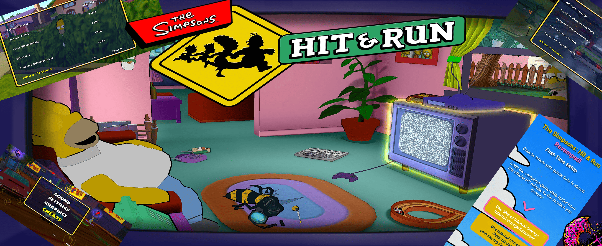

# The Simpsons Hit & Run - Revamped! (Android)

**Sprache:** [🇬🇧 English](README.md) · [🇫🇷 Français](README.fr.md) · [🇩🇪 Deutsch](README.de.md) · [🇪🇸 Español](README.es.md)

## 📥 Downloads [v1.02]

- **Android-Geräte:** [Simpsons-H.R-Revamped.apk](https://github.com/nicksevarg/The-Simpsons-Hit-and-Run-Revamped/releases/download/v1.02/Simpsons-H.R-Revamped.apk)
- **Android TV / NVIDIA Shield (optionaler Launcher):** [ATV-Launcher.apk](https://github.com/nicksevarg/The-Simpsons-Hit-and-Run-Revamped/releases/download/v1.02/ATV-Launcher.apk)

[Versionshinweise und Versionsverlauf](https://github.com/nicksevarg/The-Simpsons-Hit-and-Run-Revamped/releases/tag/v1.02)

---
Ein verbesserter Android-Port von The Simpsons: Hit & Run, der darauf abzielt, das Originalspiel mit verbesserter Grafik, erweiterter Anpassung, Touchscreen-Unterstützung, Unterstützung für Android-TV-Geräte sowie verschiedenen Fehlerbehebungen und Qualitätsverbesserungen (Quality of Life) auf Android-Geräte zu bringen.

**Wichtig:** Sie müssen Ihre eigene PC-Version des Spiels und die erforderlichen Spieldaten bereitstellen. Aus Urheberrechtsgründen sind die ursprünglichen Spieldaten nicht in diesem Projekt enthalten.

Die Hauptvision dieses Projekts besteht darin, das Originalspiel und seine ursprünglichen Spieldateien an die Grenzen zu bringen und gleichzeitig optimiert zu bleiben, um diesen legendären Simpsons-Klassiker zu modernisieren.

Diese Version basiert auf dem hervorragenden Fork von Carlox33 des ursprünglichen Switch- und Vita-Ports von ZenoArrows. Ein besonderer Dank geht an alle Beteiligten, die diesen Port möglich gemacht haben!

## ⚡ Empfohlene Spezifikationen

*(Standardeinstellungen / Cel Shading "FULL")*

- Tegra X1 oder Helio G99 [3/4 GB RAM]   (1080p / 60 FPS)
- Snapdragon 8 Gen 1/2    [8 GB RAM]     (2160p / 120 FPS)

*(Alle Verbesserungen AUS)*

- Beliebiger älterer Low/Mid-Spec SoC [2 GB RAM] (720p / 60 FPS)

Die Standardeinstellungen sind so angepasst, dass sie auf den meisten modernen Smartphones gut funktionieren.

Bitte beachten Sie: Bewegungsschärfe (Motion Blur) und Wolkenschatten können sehr GPU-intensiv sein und sind daher standardmäßig deaktiviert. 
Auf älteren oder leistungsschwächeren CPU-SoCs wird der Cel Shading "LITE"-Modus empfohlen.
Die Unterstützung für Mali GPU SoCs ist nach wie vor nicht zu 100 % garantiert.

## 📦 Installation

Wählen Sie bei Aufforderung den entsprechenden Speicherort für die Spieldaten oder lassen Sie den Port die verfügbaren Daten automatisch erkennen.

Alle Spieldaten müssen aus der ursprünglichen PC-Installation stammen und bestehen aus Folgendem:

- Ordner `art`
- Ordner `movies`
- Ordner `scripts`
- Ordner `sound`
- Alle anderen `.rcf`-Dateien im Haupt-Installationsordner, einschließlich der Sprachdatei dialog `.rcf`

Unterstützte Spieldaten-Speicherorte sind wie folgt:

- `Android\data\com.sevarg.simpsons\files`
- `Gemeinsamer interner Speicher\Simpsons`
- `Externer Speicher\Simpsons`

## 🌐 Sprachen

Unterstützung für Englisch, Français, Deutsch und Español.

Wenn die PC-Spieldaten aus einer europäischen Version stammen, können Sie jede beliebige Sprache auswählen, und die Texte im Spiel werden ebenfalls unterstützt. Die europäische Version enthält Textdaten und Videos im Spiel für alle 4 Sprachen. (Dies umfasst auch Großbritannien und Irland)

Wenn die Daten aus der nordamerikanischen Version stammen, wird die Sprache aus Kompatibilitätsgründen immer auf Englisch zurückgesetzt.

Was die Sprachausgabe im Spiel betrifft, hängt sie vom Land ab und die Sprach-Dialogdateien lauten wie folgt:

- Englisch (`dialog.rcf`): Großbritannien, Irland, USA, Kanada, Niederlande, International
- Französisch (`dialogf.rcf`): Frankreich
- Deutsch (`dialogg.rcf`): Deutschland
- Spanisch (`dialogs.rcf`): Spanien

Sie können Ihre gewünschte Sprache beim Starten des Spiels auswählen. Wenn Sie nicht über die entsprechende Sprach-Dialogdatei verfügen, aber `dialog.rcf` vorhanden ist, wird die Sprachausgabe im Spiel automatisch auf Englisch zurückgesetzt. Wenn keine Dialogdatei gefunden wird, kann das Spiel nicht geladen werden; dies dient dazu, Abstürze während des Spiels zu vermeiden.

Kopieren Sie sorgfältig alle Ihre Dateien aus dem PC-Installationsordner.

## 🎮 Steuerung

Kompatibilität mit Xbox One/Series, DualShock 4/DualSense, Switch 1/2, 8bitdo und verschiedenen anderen kompatiblen Bluetooth-Controllern.

Tastenaktionen sind in dieser Reihenfolge aufgeführt: Xbox > PlayStation > Switch. Die Steuerungen Zu Fuß / Fahren sind durch `/` getrennt.

- **Start-Taste** — Pause-Menü
- **Obere Aktionstaste** — Interagieren / Mit Auto interagieren — △ Y X
- **Linke Aktionstaste** — Angriff / Handbremse — □ X Y
- **Rechte Aktionstaste** — Sprinten umschalten / Rückwärtsfahren — ○ B A
- **Untere Aktionstaste** — Springen oder Bestätigen / Beschleunigen — ✕ A B
- **Steuerkreuz** — Menünavigation und Bewegung/Lenken
- **Linker Stick** — Menünavigation und Bewegung/Lenken
- **Rechter Stick** — Kamerasteuerung
- **Linker Schulterbutton (L1)** — Kamera-Zoom umschalten
- **Linker Trigger (L2)** — Heranzoomen / Rückwärtsfahren (Analog)
- **Rechter Schulterbutton (R1)** — Kamera zentrieren / Hupe
- **Rechter Trigger (R2)** — Herauszoomen / Beschleunigen (Analog)
- **Linker Stick Klick (L3)** — Sprinten umschalten

**Weitere Verbesserungen:**

- Integriertes Touchscreen-HUD und Steuerung mit Anpassungsoptionen für Position, Größe und Deckkraft der Touch-Tasten.
- Die gesamte Vorarbeit wurde von Carlox33 geleistet. Bitte besuchen Sie das Repository für weitere Details: https://github.com/Carlox33/The-Simpsons-Hit-and-Run-Android/blob/master/TOUCH_CONTROLS.md
- Verbessertes Kamerasystem mit schnellerer Reaktion und mehr Kamerafreiheit.
- Verbesserte Reaktionsfähigkeit und präzisere Steuerung zu Fuß.

## ✨ Qualitätsverbesserungen (Quality of Life)

- In-Game-Schalter für Grafik- und Controller-Einstellungen.
- Kompatibilität für Android-TV-Geräte mit ordnungsgemäßer Controller-Sortierung und Unterstützung für doppeltes Zurückdrücken (getestet auf NVIDIA Shield TV).
- Flexible Auswahl des Spieldaten-Speicherorts mit Unterstützung für verfügbare interne, gemeinsame und externe Speicherorte.
- Spieldaten-Erkennung beim ersten Start zur Vereinfachung der Inbetriebnahme, wenn die erforderlichen Dateien bereits vorhanden sind.
- In-Game-Cheat-Menü hinzugefügt.

## 🎨 Grafik- & visuelle Verbesserungen

**Hinzugefügte Grafikoptionen:**

- Leichter objektbasierter Cel-Shading-Effekt für einen ästhetisch ansprechenderen visuellen Stil, der dem ursprünglichen Cartoon-Stil der Simpsons sehr nahe kommt.
- Im Spiel auswählbare Rendering-Auflösungen: 480p, 720p, 1080p, 1440p und 2160p, mit optionaler dynamischer Auflösungsskalierung.
- Konfigurierbare anisotrope Texturfilterung von 2× bis 16× zur Verbesserung der Texturschärfe bei entfernten und schrägen Blickwinkeln.
- Einstellbare Bildschärfung mit konfigurierbarer Stärke und Option zum Aktivieren/Deaktivieren.
- Leichtes bikubisches Upscaling für die niedrig aufgelösten 3D-Renderszenen des Spiels.
- Konfigurierbarer Bloom-Effekt zur Verbesserung der Darstellung von Lichtern und Spezialeffekten.
- Verbesserte Sonnenlicht-Blendeffekte und ausgewogenere Beleuchtung.
- Experimentelle animierte Wolkenschatten-Effekte für Außenbereiche bei Tageslicht.
- Optionale Randbeleuchtung (Rim lighting) für Charakter- und Fahrzeugkanten.
- **CRT-Filter:** Ein optionaler Effekt im CRT-Geom-Stil, der das Erscheinungsbild eines Fernsehers aus den 1990er Jahren imitiert.
- **Bewegungsunschärfe (Motion blur):** Ein kamerabezogener Effekt, der auf Fahrzeugbewegung, Rücklicht-Spuren und den unteren Bildschirmbereich fokussiert ist.
- Erhöhte Sichtweite der Umgebung, sodass mehr von der Spielwelt sichtbar bleibt, zusammen mit erhöhten Darstellungsdistanzen für Fußgänger und Fahrzeuge sowie flüssigeren Animationen entfernter Fußgänger.

## 🛠️ Standard-Grafikkonfiguration

| Einstellung | Standardwert |
| --- | --- |
| Auflösung | 1080p |
| Cel Shading | An (Full) |
| Anisotrope Filterung | 4× |
| Bloom | An |
| Wolkenschatten | Aus |
| Bildschärfung | 40 % |
| CRT-Filter | Aus |
| Bewegungsunschärfe | Aus |
| Randbeleuchtung (Rim lighting) | Aus |
| FPS-Begrenzung | 60 FPS |
| Dynamische Auflösungsskalierung | Aus |

## 🧪 Experimentelle Funktionen

Einige Funktionen bleiben experimentell und können je nach Gerät variieren:

- Höhere FPS-Begrenzungen (90, 120 und 144 FPS)
- Wolkenschatten-Rendering

## 🔬 Zukünftige Funktionen

- Verfeinerung der Kompatibilität für weitere Sprachen.
- Erforschung einer möglichen Kompatibilität mit Spieldaten der PS2-, GameCube- und Xbox-Releases.
- Automatische Extraktion von Spieldaten aus Disc-Image-Dateien.
- iOS-Portierung (derzeit in der Anfangsphase).
