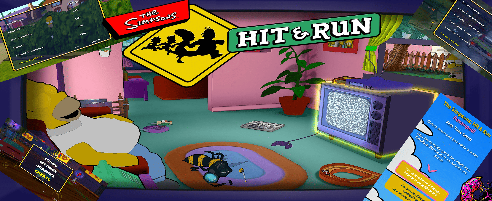

# The Simpsons Hit & Run - Revamped! (Android)

**Language:** [🇬🇧 English](README.md) · [🇫🇷 Français](README.fr.md) · [🇩🇪 Deutsch](README.de.md) · [🇪🇸 Español](README.es.md)

## 📥 Downloads [v1.02]

- **Android Devices:** [Simpsons-H.R-Revamped.apk](https://github.com/nicksevarg/The-Simpsons-Hit-and-Run-Revamped/releases/download/v1.02/Simpsons-H.R-Revamped.apk)
- **Android TV / NVIDIA Shield (Optional Launcher):** [ATV-Launcher.apk](https://github.com/nicksevarg/The-Simpsons-Hit-and-Run-Revamped/releases/download/v1.02/ATV-Launcher.apk)

[Release notes and version history](https://github.com/nicksevarg/The-Simpsons-Hit-and-Run-Revamped/releases/tag/v1.02)

---
An enhanced Android port of The Simpsons: Hit & Run that focuses on bringing the original game to Android devices with improved graphics, expanded customization, touch screen support, support for Android TV devices, as well as various bug fixes and quality of life improvements.

**Important:** You must provide your own PC version of the game and its required game data. Due to copyright reasons, the original game data is not included with this project.

The main vision this project is to push the original game and its original game assets to the limit while remaining optimized with a goal to modernize this legendary Simpsons game.

This version is based on the excellent Carlox33's fork of ZenoArrows's original Switch and Vita port of the game. A special thanks to everyone involved in making this port possible!

## ⚡ Recommended Specs

*(Stock Settings / Cel Shading "FULL")*

- Tegra X1 or Helio G99 [3/4GB RAM]   (1080p / 60FPS) 
- Snapdragon 8 Gen 1/2    [8GB RAM]   (2160p / 120FPS)

*(All Enhancements OFF)*

- Any older low/mid spec SoC [2GB RAM] (720p / 60FPS)

Stock settings are fine tuned to work nicely on most modern smartphones.

Please note: Motion Blur and Cloud Shadows can be quite GPU intensive, so they are toggled off by default. 
On older or low spec CPU SoCs, Cel Shading "LITE" mode is recommended.
Support for Mali GPU SoCs is still not 100% guaranteed.

## 📦 Installation

Select the appropriate game-data location when prompted, or allow the port to detect available data.

All game data must be sourced from the original PC install and consists of the following:

- `art` folder
- `movies` folder
- `scripts` folder
- `sound` folder
- All other `.rcf` files located in the parent install folder, including the language dialog `.rcf` file

Supported game-data locations:

- `Android\data\com.sevarg.simpsons\files`
- `Shared Internal\Simpsons`
- `External\Simpsons`

## 🌐 Languages

Support for English, Français, Deutsch and Español.

If PC game data is sourced from any European release, you can select any language you like and in-game text will also be supported. The European release has in-game text data and videos for all 4 languages. (This includes UK and Ireland)

If sourced from the North American release, for compatibility reasons the language will always default back to English.

As for in-game dialog, it will depend on the country and the language dialog files are as follows:

- English (`dialog.rcf`): UK, Ireland, USA, Canada, Netherlands, International
- Français (`dialogf.rcf`): France
- Deutsch (`dialogg.rcf`): Germany
- Español (`dialogs.rcf`): Spain

You can select your desired language when opening the game. If you do not have the correct respective dialog language file, and `dialog.rcf` is also present, then the game dialog will automatically default back to English. If no dialog file is found, the game will fail to load; this is to mitigate gameplay crashes.

Carefully copy all your files from the PC install folder.

## 🎮 Controls

Compatibility with Xbox One/Series, DualShock 4/DualSense, Switch 1/2, 8bitdo and various other compatible Bluetooth controllers.

Button actions are listed in this order: Xbox > PlayStation > Switch. On-foot / Driving controls are separated with `/`.

- **Start button** — Pause Menu
- **Top face button** — Interact / Interact with car — △ Y X
- **Left face button** — Attack / Handbrake — □ X Y
- **Right face button** — Toggle sprint / Reverse — ○ B A
- **Bottom face button** — Jump or Confirm / Accelerate — ✕ A B
- **D-pad** — Menu navigation and Movement/Steering
- **Left stick** — Menu navigation and Movement/Steering
- **Right stick** — Camera control
- **Left shoulder (L1)** — Switch camera zoom
- **Left trigger (L2)** — Zoom in / Reverse (Analog)
- **Right shoulder (R1)** — Centre camera / Car horn
- **Right trigger (R2)** — Zoom out / Accelerate (Analog)
- **Left stick click (L3)** — Toggle sprint

**Control Improvements:**

- Integrated touchscreen HUD and controls with customization options for touch-button placement, size and opacity.
- All the hard work was done by Carlox33, so please check out their repository for more details: https://github.com/Carlox33/The-Simpsons-Hit-and-Run-Android/blob/master/TOUCH_CONTROLS.md
- Improved camera system with faster response and more camera freedom.
- Improved responsiveness and tighter controls when on foot.

## ✨ Quality of Life Improvements

- In-game toggles for graphics and controller settings.
- Compatibility for Android TV devices with proper controller ordering and double-back support (tested on NVIDIA Shield TV).
- Flexible game-data location selection, with support for available internal, shared and external storage locations.
- First-launch game-data detection to simplify startup when the required files are already available.
- In-game cheats menu added.

## 🎨 Graphics & Visual Improvements

**Graphics options added:**

- Lightweight object based cel-shading effect for a more aesthetically pleasing visual style, closely matching the original cartoon style of The Simpsons.
- In-game selectable rendering resolutions: 480p, 720p, 1080p, 1440p and 2160p, with optional Dynamic Resolution Scaling.
- Configurable anisotropic texture filtering from 4× to 16×, improving texture clarity at distant and oblique angles.
- Adjustable image sharpening, with configurable strength and an enable/disable option.
- Lightweight bicubic upscaling for the game's low-resolution, 3D-rendered cutscenes.
- Configurable bloom to enhance the appearance of lights and special effects.
- Improved sunlight glare and lighting balance.
- Experimental animated cloud-shadow effects for outdoor daytime environments.
- Optional rim lighting for character and vehicle edges.
- **CRT filter:** An optional CRT-Geom-style effect that imitates the appearance of a 1990s television.
- **Motion blur:** A camera-aware effect focused on vehicle motion, tail separation and the lower portion of the screen.
- Increased scenery draw distance, allowing more of the game world to remain visible, with increased pedestrian and vehicle rendering distances and smoother animation of distant pedestrians.

## 🛠️ Default Graphics Configuration

| Setting | Default |
| --- | --- |
| Resolution | 1080p |
| Cel Shading | On (Full) |
| Anisotropic Filtering | 4× |
| Bloom | On |
| Cloud Shadows | Off |
| Sharpening | Off |
| CRT Filter | Off |
| Motion Blur | Off |
| Rim Lighting | Off |
| FPS Cap | 60 FPS |
| Dynamic Resolution Scaling | Off |

## 🧪 Experimental Features

Some features remain experimental and may vary by device:

- Higher FPS caps (90, 120 and 144 FPS)
- Cloud-shadow rendering

## 🔬 Upcoming Features

- Refining compatibility for other languages.
- Researching possible compatibility with game data from PS2, GameCube and Xbox releases.
- Automatic extraction of game data from disc-image files.
- iOS port (at the initial stages)
